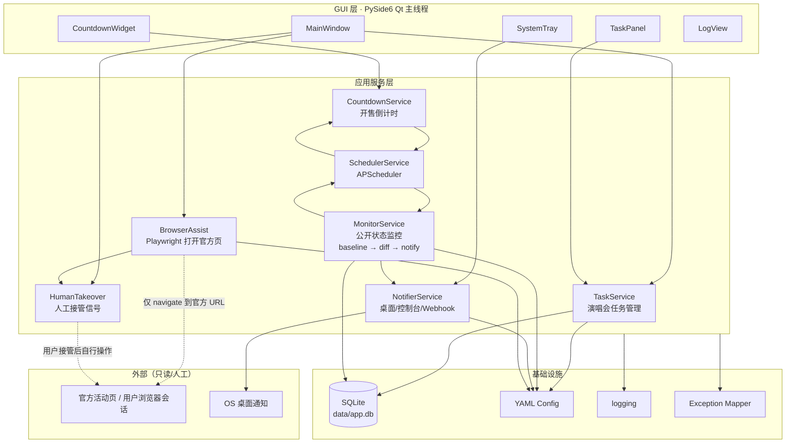
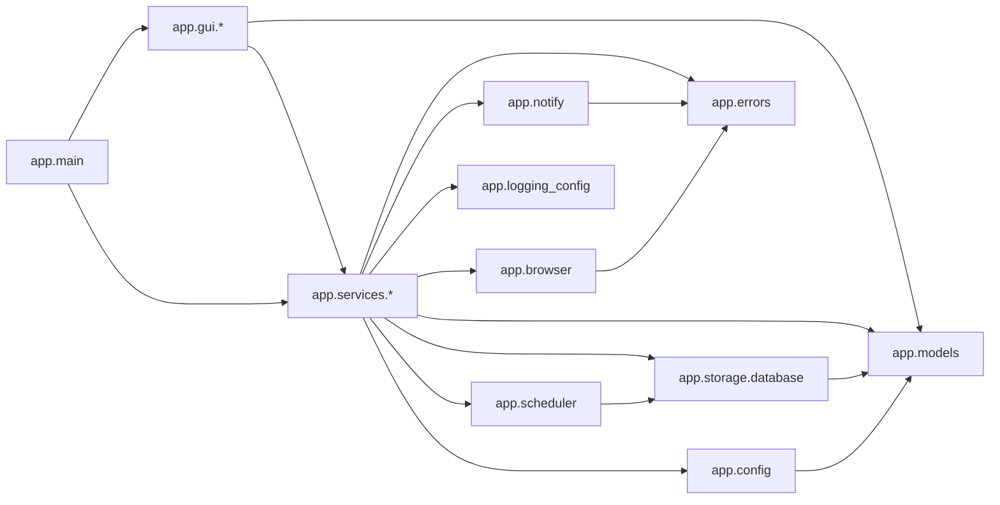
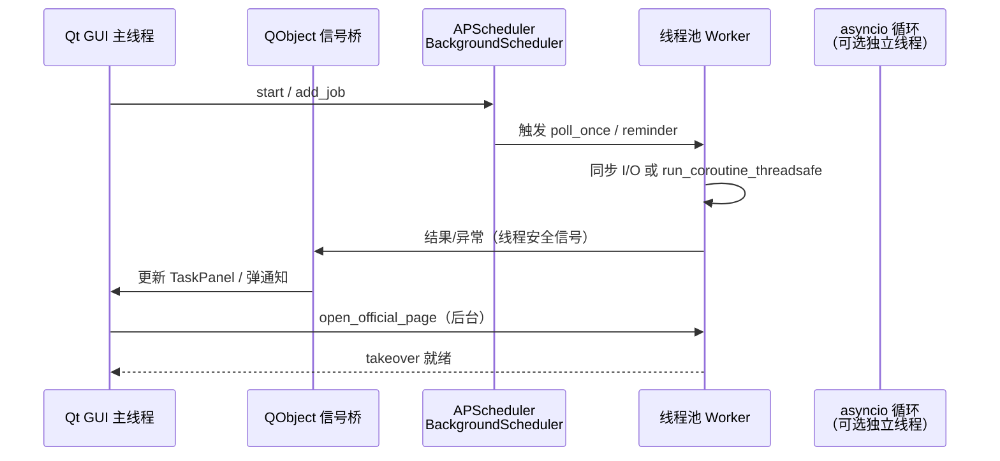

# Damai Ticket Assistant — 系统架构设计

> **阶段**：第三阶段（仅设计，不实现业务模块）  
> **定位**：大麦演唱会 **开售监控 / 提醒 / 人工辅助打开官方页**  
> **明确禁止**：自动购票、验证码绕过、插队、反风控/指纹伪装、多账号、任何抢票逻辑  
> **运行时基线**：Python **3.13.5**；已验证依赖 PySide6 6.12、playwright 1.64、APScheduler 3.11、PyYAML、PyInstaller（见阶段一）

相关文档：[调研报告](research_report.md) · [数据库设计](database_design.md) · [开发计划](development_plan.md)

---

## 1. 产品边界（必须遵守）

| 允许 | 禁止 |
|------|------|
| 管理演唱会/开售任务（CRUD） | 自动提交订单 / 自动选座结账 |
| 开售倒计时与到点提醒 | 验证码打码、滑块破解 |
| 对**用户提供的公开 URL/字段**做低频状态差分 | 队列插队、伪造设备指纹、stealth 插件 |
| 桌面/托盘/可选 Webhook 通知 | 多账号 Cookie 池并发 |
| Playwright **打开官方页**并交还人工操作 | 任何「抢」「秒杀」「下单重试」命名与实现 |
| 用户手动录入开售时间（零抓取模式） | 复制第三方抢票仓请求链 / mtop 签名复刻 |

配置中的 `app.mode` 固定语义为 `monitor_reminder`；代码与 UI 文案不得出现「开始抢票」类动作。

---

## 2. 系统架构总览



**数据主路径（监控）**：

1. 用户创建 `WatchTask`（官方 URL 或纯手动开售时间）。  
2. `SchedulerService` 按礼貌间隔触发 `MonitorService.poll`。  
3. 首次结果写入 **baseline**，不通知。  
4. 后续快照与 baseline/上次快照 **diff**；仅在「开售状态/文案关键字段」变化时调用 `NotifierService`。  
5. 用户可随时「打开官方页」→ Playwright 导航 → **HumanTakeover**（停止自动化导航以外的一切动作）。

---

## 3. 模块依赖关系



依赖规则：

- `gui` 只依赖服务接口与模型，**不直接**操作 SQLite 或 Playwright。  
- `browser` **不得**依赖 `monitor` 的解析结果去「继续下单」。  
- `notify` 无站点访问权限。  
- 禁止出现 `checkout` / `captcha` / `account_pool` 包名。

---

## 4. 目标目录布局（后续实现阶段按此落地）

```text
damai-ticket-assistant/
├── app/
│   ├── __init__.py
│   ├── main.py                 # CLI / GUI 入口分派
│   ├── config.py               # 加载 settings.yaml
│   ├── models.py               # dataclass 领域模型
│   ├── errors.py               # 异常体系
│   ├── logging_config.py
│   ├── storage/
│   │   ├── __init__.py
│   │   ├── database.py         # 连接、迁移、仓储
│   │   └── schema.sql
│   ├── services/
│   │   ├── __init__.py
│   │   ├── task_service.py     # 演唱会任务管理
│   │   ├── countdown_service.py
│   │   ├── monitor_service.py  # 公开状态监控
│   │   └── takeover_service.py # 人工接管状态机
│   ├── scheduler/
│   │   ├── __init__.py
│   │   └── jobs.py             # APScheduler 封装
│   ├── notify/
│   │   ├── __init__.py
│   │   ├── base.py             # Notifier Protocol
│   │   ├── console.py
│   │   ├── desktop.py          # plyer / desktop-notifier / Qt 托盘
│   │   └── webhook.py          # 可选
│   ├── browser/
│   │   ├── __init__.py
│   │   └── assist.py           # 仅 open_official_page
│   └── gui/
│       ├── main_window.py
│       ├── task_panel.py
│       ├── countdown_widget.py
│       └── tray.py
├── config/
│   ├── settings.example.yaml
│   └── settings.yaml           # gitignore
├── data/
│   ├── app.db                  # gitignore
│   └── logs/                   # gitignore
├── docs/
│   ├── architecture.md
│   ├── database_design.md
│   ├── development_plan.md
│   └── research_report.md
├── tests/
├── scripts/
├── requirements.txt
└── README.md
```

---

## 5. 模块职责与接口定义

下列签名为 **实现契约**（Python 3.13 风格）；实现阶段可微调，但不得突破产品边界。

### 5.1 演唱会任务管理 — `TaskService`

```python
from dataclasses import dataclass
from datetime import datetime
from typing import Protocol, Sequence

@dataclass(frozen=True, slots=True)
class ConcertTask:
    id: int | None
    name: str
    city: str | None
    official_url: str | None          # 必须是 https 官方域（校验白名单）
    open_sale_at: datetime | None     # Asia/Shanghai 语义
    monitor_enabled: bool
    note: str | None
    created_at: datetime
    updated_at: datetime

class TaskService(Protocol):
    def create(self, task: ConcertTask) -> ConcertTask: ...
    def update(self, task_id: int, **fields) -> ConcertTask: ...
    def delete(self, task_id: int) -> None: ...
    def get(self, task_id: int) -> ConcertTask | None: ...
    def list_all(self) -> Sequence[ConcertTask]: ...
    def set_monitor(self, task_id: int, enabled: bool) -> None: ...
```

### 5.2 开售倒计时 — `CountdownService`

```python
@dataclass(frozen=True, slots=True)
class CountdownSnapshot:
    task_id: int
    open_sale_at: datetime
    remaining_seconds: float          # <0 表示已过开售点
    phase: str                        # "upcoming" | "due" | "past"

class CountdownService(Protocol):
    def snapshot(self, task_id: int, now: datetime | None = None) -> CountdownSnapshot: ...
    def schedule_reminders(self, task_id: int, offsets_seconds: Sequence[int]) -> None:
        """例如开售前 3600/600/60 秒各提醒一次；到点提醒一次。"""
    ...
```

GUI 可用 `QTimer`（1s）刷新展示；**真正的到点通知**由 APScheduler date 触发器发出，避免仅依赖 UI 定时器。

### 5.3 公开销售状态监控 — `MonitorService`

```python
@dataclass(frozen=True, slots=True)
class SaleStatusSnapshot:
    task_id: int
    fetched_at: datetime
    source_url: str
    raw_excerpt: str                  # 有限长度公开文案摘录
    normalized_status: str            # "unknown"|"pre_sale"|"on_sale"|"sold_out"|"off_sale"
    content_hash: str                 # 用于 diff

@dataclass(frozen=True, slots=True)
class StatusDiff:
    task_id: int
    previous: SaleStatusSnapshot | None
    current: SaleStatusSnapshot
    changed_fields: tuple[str, ...]
    should_notify: bool

class MonitorService(Protocol):
    def establish_baseline(self, task_id: int) -> SaleStatusSnapshot: ...
    def poll_once(self, task_id: int) -> StatusDiff: ...
    def min_poll_interval_seconds(self) -> int:  # 配置下限，例如 ≥ 60
        ...
```

规则：

- **baseline 轮不通知**。  
- 仅当 `normalized_status` 或用户勾选的关键字段变化时 `should_notify=True`。  
- 拉取方式优先：用户粘贴的公开页只读 GET / 浏览器打开后由用户确认；**不**实现私有签名 API、不携带多账号 Cookie 池。  
- interval 必须 ≥ `monitor.poll_interval_seconds`，并加 **jitter**，禁止亚秒级轮询。

### 5.4 桌面通知 — `Notifier`

```python
class Notifier(Protocol):
    name: str
    def send(self, title: str, message: str, *, urgent: bool = False) -> bool: ...

class NotifierService(Protocol):
    def register(self, notifier: Notifier) -> None: ...
    def notify_sale_reminder(self, task: ConcertTask, snapshot: CountdownSnapshot) -> None: ...
    def notify_status_change(self, task: ConcertTask, diff: StatusDiff) -> None: ...
```

通道：`console`（必选）→ `desktop`（OS 通知 / Qt 托盘）→ 可选 `webhook`（URL 仅存本地 `settings.yaml`）。

### 5.5 浏览器辅助 — `BrowserAssist`

```python
@dataclass(frozen=True, slots=True)
class BrowserSessionInfo:
    task_id: int
    official_url: str
    launched_at: datetime

class BrowserAssist(Protocol):
    def open_official_page(self, task_id: int, url: str) -> BrowserSessionInfo:
        """使用 Playwright 启动可见浏览器并 goto 官方 URL；禁止 stealth。"""
    def close(self, task_id: int) -> None: ...
```

硬约束：

- `headless=False` 为默认（方便人工）。  
- **禁止**安装/引用 stealth、fingerprint、代理撞风控相关依赖。  
- API 命名只用 `open_official_page`，禁用 `buy` / `grab` / `checkout`。  
- 失败时降级：调用系统默认浏览器打开同一 URL。

### 5.6 人工接管 — `HumanTakeover`

```python
from enum import Enum

class TakeoverState(Enum):
    IDLE = "idle"
    BROWSER_ASSIST = "browser_assist"
    HUMAN_ACTIVE = "human_active"   # 应用停止对该页的一切自动导航/点击

class TakeoverService(Protocol):
    def request_takeover(self, task_id: int) -> TakeoverState: ...
    def state(self, task_id: int) -> TakeoverState: ...
    def release(self, task_id: int) -> TakeoverState: ...
```

进入 `HUMAN_ACTIVE` 后：监控轮询可继续（只读差分），但 **BrowserAssist 不得再对页面执行任何操作**。

### 5.7 数据库 — `Database` / 仓储

见 [database_design.md](database_design.md)。接口摘要：

```python
class Database(Protocol):
    def connect(self, path: str) -> None: ...
    def migrate(self) -> None: ...
    def execute(self, sql: str, params: tuple = ()) -> None: ...
```

### 5.8 任务调度 — `SchedulerService`

```python
class SchedulerService(Protocol):
    def start(self) -> None: ...
    def shutdown(self, wait: bool = True) -> None: ...
    def add_date_job(self, job_id: str, run_at: datetime, func, **kwargs) -> None: ...
    def add_interval_job(self, job_id: str, seconds: int, func, **kwargs) -> None: ...
    def remove_job(self, job_id: str) -> None: ...
```

实现选用 `BackgroundScheduler`（线程池执行），**不要**在 Qt GUI 线程跑阻塞 I/O。

### 5.9 日志 — `logging_config`

- 标准库 `logging`；按模块命名 `damai.*`。  
- 文件：`data/logs/app.log`（轮转）；控制台 Handler 在开发模式启用。  
- **禁止**记录完整 Cookie、密码、Webhook 密钥；URL 可记 host+path，query 中的 token 需脱敏。

### 5.10 异常处理 — `app.errors`

```python
class AppError(Exception):
    """应用可预期错误基类。"""
    code: str
    user_message: str

class ConfigError(AppError): ...
class ValidationError(AppError): ...          # URL 非白名单、间隔过小等
class StorageError(AppError): ...
class MonitorFetchError(AppError): ...        # 网络/解析失败，可重试
class BrowserAssistError(AppError): ...
class ScheduleError(AppError): ...
class NotifyError(AppError): ...              # 单通道失败不致命
```

策略：

| 层级 | 策略 |
|------|------|
| 服务层 | 捕获并转为 `AppError`；记录 `exc_info`（脱敏后） |
| 调度作业 | 单任务失败不影响其他 job；连续 N 次失败暂停该任务监控并通知用户 |
| GUI | 槽函数只展示 `user_message`；未知异常弹窗 + 写日志 |
| 通知通道 | 失败吞掉并打 warning，换下一通道 |

### 5.11 GUI — PySide6

| 组件 | 职责 |
|------|------|
| `MainWindow` | 布局、菜单（添加任务 / 打开官方页 / 请求接管 / 设置） |
| `TaskPanel` | 任务列表、启用监控开关、状态列 |
| `CountdownWidget` | 本地倒计时展示 |
| `SystemTray` | 托盘图标、到点气泡、显示/隐藏主窗 |
| 信号 | 服务层通过 `QObject` 信号桥把后台事件编回主线程 |

---

## 6. 并发模型：Qt ↔ asyncio ↔ APScheduler

Python 3.13 + PySide6 6.12 场景下推荐 **「Qt 主线程 + APScheduler 线程池 + 有限 asyncio」**：



细则：

1. **GUI 绝不阻塞**：所有网络、Playwright、SQLite 写繁忙路径放 Worker。  
2. **APScheduler**：`BackgroundScheduler(executors={"default": ThreadPoolExecutor(...)})`，与 Qt 并存最简单。  
3. **asyncio**：若 Playwright 使用异步 API，在 **专用守护线程** 跑 `asyncio.new_event_loop()`，用 `asyncio.run_coroutine_threadsafe` 提交；**不要**强行把 asyncio 嵌进 Qt 事件循环（避免 `qasync` 强耦合，除非后续单独立项）。  
4. **SQLite**：`check_same_thread=False` + 连接锁，或每线程短连接；开启 WAL。  
5. **关机顺序**：先 `scheduler.shutdown(wait=True)` → 关闭浏览器 → 刷盘 → `QApplication.quit`。

---

## 7. 安全与 ToS 边界

1. 官方 URL **白名单校验**（例如仅允许 `damai.cn` 及相关官方文档列出的域名）；拒绝任意第三方短链跳转自动跟随到未知域。  
2. 不落盘明文长效会话密钥；若未来用户自愿导出 storage state，必须提示风险并默认关闭。  
3. `poll_interval_seconds` 强制下限；尊重站点机器人条款。  
4. 无合规公开数据源时，功能降级为 **纯手动开售时间提醒**（调研报告结论）。  
5. 许可证：分发时附带 PySide6（LGPL/GPL）、PyInstaller（GPL + Bootloader Exception）、Playwright（Apache-2.0）等声明。

---

## 8. 与现有脚手架的映射

| 现状 | 架构落点 |
|------|----------|
| `app/main.py` 打印 banner | 扩展为 CLI `--gui` / 默认服务自检，再启 GUI |
| `config/settings.example.yaml` | `app.config` 加载；补齐 `browser` / `reminders` / `url_allowlist` 键（实现阶段） |
| `requirements.txt` | 已含核心依赖；测试阶段再加 `pytest`（可不进运行时依赖） |
| `data/` | SQLite + logs |
| 模式文案 `monitor_reminder` | 全模块默认契约 |

---

## 9. 非目标清单（防止范围蔓延）

- Appium / uiautomator2 手机抢票  
- 验证码服务、代理池、多开浏览器指纹  
- 「余票精确到票档并自动锁单」  
- 复现 HaTickets / shiyutim/tickets 等仓库行为  

本文件只定义架构；实现按 [development_plan.md](development_plan.md) 分阶段、阶段间暂停等待指令。
