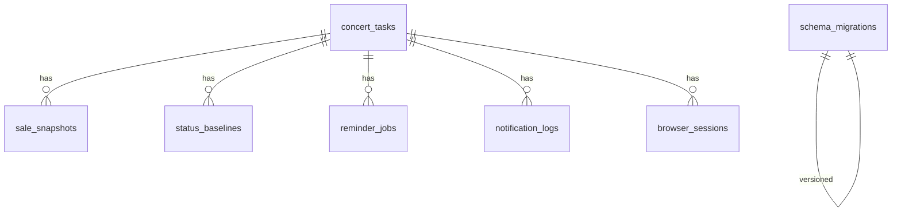

# Damai Ticket Assistant — 数据库设计

> SQLite 本地库 · 路径默认 `data/app.db` · 时区语义 **Asia/Shanghai**  
> 仅服务监控 / 提醒 / 审计日志，不存储「下单载荷」或验证码相关表。

配套：[架构设计](architecture.md) · [开发计划](development_plan.md)

---

## 1. 设计原则

1. **本地单用户**：无需多租户；外键 `ON DELETE CASCADE` 用于任务清理。  
2. **WAL 模式**：读写与 GUI/调度并发更友好。  
3. **不存秘密**：禁止 `cookies` / `password` / `captcha` 表；Webhook URL 优先放配置文件而非 DB。  
4. **审计可删**：通知日志与快照可按保留策略裁剪。  
5. **迁移简单**：`schema_migrations` 表 + 递增整数版本；初期可用单文件 `schema.sql`。

---

## 2. ER 关系（逻辑）



---

## 3. 表结构

### 3.1 `schema_migrations`

| 列 | 类型 | 约束 | 说明 |
|----|------|------|------|
| version | INTEGER | PK | 迁移版本号 |
| applied_at | TEXT | NOT NULL | ISO8601 |

### 3.2 `concert_tasks`（演唱会 / 监控任务）

| 列 | 类型 | 约束 | 说明 |
|----|------|------|------|
| id | INTEGER | PK AUTOINCREMENT | |
| name | TEXT | NOT NULL | 演出名称 |
| city | TEXT | NULL | 城市 |
| official_url | TEXT | NULL | 官方详情 URL |
| open_sale_at | TEXT | NULL | ISO8601，含偏移 |
| monitor_enabled | INTEGER | NOT NULL DEFAULT 0 | 0/1 |
| note | TEXT | NULL | |
| created_at | TEXT | NOT NULL | |
| updated_at | TEXT | NOT NULL | |

索引：

- `idx_concert_tasks_open_sale_at` ON `(open_sale_at)`  
- `idx_concert_tasks_monitor` ON `(monitor_enabled)`

### 3.3 `status_baselines`（每任务一条基线）

| 列 | 类型 | 约束 | 说明 |
|----|------|------|------|
| task_id | INTEGER | PK, FK → concert_tasks(id) ON DELETE CASCADE | |
| established_at | TEXT | NOT NULL | 首轮采样时间 |
| normalized_status | TEXT | NOT NULL | 与快照枚举一致 |
| content_hash | TEXT | NOT NULL | |
| raw_excerpt | TEXT | NOT NULL DEFAULT '' | 长度上限应用层控制（如 4KiB） |

### 3.4 `sale_snapshots`（历史快照）

| 列 | 类型 | 约束 | 说明 |
|----|------|------|------|
| id | INTEGER | PK AUTOINCREMENT | |
| task_id | INTEGER | NOT NULL, FK CASCADE | |
| fetched_at | TEXT | NOT NULL | |
| source_url | TEXT | NOT NULL | |
| raw_excerpt | TEXT | NOT NULL | |
| normalized_status | TEXT | NOT NULL | `unknown`/`pre_sale`/`on_sale`/`sold_out`/`off_sale` |
| content_hash | TEXT | NOT NULL | |
| is_baseline | INTEGER | NOT NULL DEFAULT 0 | 1=基线轮 |

索引：

- `idx_sale_snapshots_task_time` ON `(task_id, fetched_at DESC)`  
- `idx_sale_snapshots_hash` ON `(task_id, content_hash)`

### 3.5 `reminder_jobs`（与 APScheduler job_id 映射）

| 列 | 类型 | 约束 | 说明 |
|----|------|------|------|
| id | INTEGER | PK AUTOINCREMENT | |
| task_id | INTEGER | NOT NULL, FK CASCADE | |
| scheduler_job_id | TEXT | NOT NULL UNIQUE | 如 `remind:{task_id}:{offset}` |
| kind | TEXT | NOT NULL | `countdown_offset` / `sale_due` / `monitor_interval` |
| run_at | TEXT | NULL | date 型任务的计划时间 |
| interval_seconds | INTEGER | NULL | interval 型 |
| status | TEXT | NOT NULL | `scheduled`/`paused`/`done`/`cancelled` |
| created_at | TEXT | NOT NULL | |

索引：`idx_reminder_jobs_task` ON `(task_id, status)`

### 3.6 `notification_logs`

| 列 | 类型 | 约束 | 说明 |
|----|------|------|------|
| id | INTEGER | PK AUTOINCREMENT | |
| task_id | INTEGER | NULL, FK SET NULL | 任务删除后可保留审计 |
| channel | TEXT | NOT NULL | console/desktop/webhook/tray |
| title | TEXT | NOT NULL | |
| body | TEXT | NOT NULL | |
| success | INTEGER | NOT NULL | 0/1 |
| error_message | TEXT | NULL | 脱敏后 |
| created_at | TEXT | NOT NULL | |

索引：`idx_notification_logs_created` ON `(created_at DESC)`

### 3.7 `browser_sessions`（辅助打开记录，非 Cookie 仓）

| 列 | 类型 | 约束 | 说明 |
|----|------|------|------|
| id | INTEGER | PK AUTOINCREMENT | |
| task_id | INTEGER | NOT NULL, FK CASCADE | |
| official_url | TEXT | NOT NULL | |
| launched_at | TEXT | NOT NULL | |
| closed_at | TEXT | NULL | |
| takeover_state | TEXT | NOT NULL | idle/browser_assist/human_active |
| notes | TEXT | NULL | 如「已降级系统浏览器」 |

**禁止列**：`cookies`, `storage_state`, `password`, `proxy`, `fingerprint`。

---

## 4. 建表 DDL 草案

```sql
PRAGMA foreign_keys = ON;
PRAGMA journal_mode = WAL;

CREATE TABLE IF NOT EXISTS schema_migrations (
  version INTEGER PRIMARY KEY,
  applied_at TEXT NOT NULL
);

CREATE TABLE IF NOT EXISTS concert_tasks (
  id INTEGER PRIMARY KEY AUTOINCREMENT,
  name TEXT NOT NULL,
  city TEXT,
  official_url TEXT,
  open_sale_at TEXT,
  monitor_enabled INTEGER NOT NULL DEFAULT 0 CHECK (monitor_enabled IN (0, 1)),
  note TEXT,
  created_at TEXT NOT NULL,
  updated_at TEXT NOT NULL
);

CREATE INDEX IF NOT EXISTS idx_concert_tasks_open_sale_at
  ON concert_tasks(open_sale_at);
CREATE INDEX IF NOT EXISTS idx_concert_tasks_monitor
  ON concert_tasks(monitor_enabled);

CREATE TABLE IF NOT EXISTS status_baselines (
  task_id INTEGER PRIMARY KEY,
  established_at TEXT NOT NULL,
  normalized_status TEXT NOT NULL,
  content_hash TEXT NOT NULL,
  raw_excerpt TEXT NOT NULL DEFAULT '',
  FOREIGN KEY (task_id) REFERENCES concert_tasks(id) ON DELETE CASCADE
);

CREATE TABLE IF NOT EXISTS sale_snapshots (
  id INTEGER PRIMARY KEY AUTOINCREMENT,
  task_id INTEGER NOT NULL,
  fetched_at TEXT NOT NULL,
  source_url TEXT NOT NULL,
  raw_excerpt TEXT NOT NULL,
  normalized_status TEXT NOT NULL,
  content_hash TEXT NOT NULL,
  is_baseline INTEGER NOT NULL DEFAULT 0 CHECK (is_baseline IN (0, 1)),
  FOREIGN KEY (task_id) REFERENCES concert_tasks(id) ON DELETE CASCADE
);

CREATE INDEX IF NOT EXISTS idx_sale_snapshots_task_time
  ON sale_snapshots(task_id, fetched_at DESC);
CREATE INDEX IF NOT EXISTS idx_sale_snapshots_hash
  ON sale_snapshots(task_id, content_hash);

CREATE TABLE IF NOT EXISTS reminder_jobs (
  id INTEGER PRIMARY KEY AUTOINCREMENT,
  task_id INTEGER NOT NULL,
  scheduler_job_id TEXT NOT NULL UNIQUE,
  kind TEXT NOT NULL,
  run_at TEXT,
  interval_seconds INTEGER,
  status TEXT NOT NULL,
  created_at TEXT NOT NULL,
  FOREIGN KEY (task_id) REFERENCES concert_tasks(id) ON DELETE CASCADE
);

CREATE INDEX IF NOT EXISTS idx_reminder_jobs_task
  ON reminder_jobs(task_id, status);

CREATE TABLE IF NOT EXISTS notification_logs (
  id INTEGER PRIMARY KEY AUTOINCREMENT,
  task_id INTEGER,
  channel TEXT NOT NULL,
  title TEXT NOT NULL,
  body TEXT NOT NULL,
  success INTEGER NOT NULL CHECK (success IN (0, 1)),
  error_message TEXT,
  created_at TEXT NOT NULL,
  FOREIGN KEY (task_id) REFERENCES concert_tasks(id) ON DELETE SET NULL
);

CREATE INDEX IF NOT EXISTS idx_notification_logs_created
  ON notification_logs(created_at DESC);

CREATE TABLE IF NOT EXISTS browser_sessions (
  id INTEGER PRIMARY KEY AUTOINCREMENT,
  task_id INTEGER NOT NULL,
  official_url TEXT NOT NULL,
  launched_at TEXT NOT NULL,
  closed_at TEXT,
  takeover_state TEXT NOT NULL,
  notes TEXT,
  FOREIGN KEY (task_id) REFERENCES concert_tasks(id) ON DELETE CASCADE
);
```

---

## 5. 核心数据模型（应用层）

与表对应的 `dataclass`（可用 `slots=True`；若引入 Pydantic v2 亦可，但非必须——当前 `requirements.txt` 未锁定 Pydantic，**默认 dataclass + 手工校验**）。

```python
from dataclasses import dataclass
from datetime import datetime
from typing import Literal

NormalizedStatus = Literal[
    "unknown", "pre_sale", "on_sale", "sold_out", "off_sale"
]

TakeoverStateName = Literal["idle", "browser_assist", "human_active"]

@dataclass(slots=True)
class ConcertTaskModel:
    id: int | None
    name: str
    city: str | None
    official_url: str | None
    open_sale_at: datetime | None
    monitor_enabled: bool
    note: str | None
    created_at: datetime
    updated_at: datetime

@dataclass(slots=True)
class SaleSnapshotModel:
    id: int | None
    task_id: int
    fetched_at: datetime
    source_url: str
    raw_excerpt: str
    normalized_status: NormalizedStatus
    content_hash: str
    is_baseline: bool

@dataclass(slots=True)
class StatusBaselineModel:
    task_id: int
    established_at: datetime
    normalized_status: NormalizedStatus
    content_hash: str
    raw_excerpt: str

@dataclass(slots=True)
class ReminderJobModel:
    id: int | None
    task_id: int
    scheduler_job_id: str
    kind: Literal["countdown_offset", "sale_due", "monitor_interval"]
    run_at: datetime | None
    interval_seconds: int | None
    status: Literal["scheduled", "paused", "done", "cancelled"]
    created_at: datetime

@dataclass(slots=True)
class NotificationLogModel:
    id: int | None
    task_id: int | None
    channel: str
    title: str
    body: str
    success: bool
    error_message: str | None
    created_at: datetime

@dataclass(slots=True)
class BrowserSessionModel:
    id: int | None
    task_id: int
    official_url: str
    launched_at: datetime
    closed_at: datetime | None
    takeover_state: TakeoverStateName
    notes: str | None
```

校验要点：

- `official_url`：HTTPS + 域名白名单。  
- `monitor_enabled=True` 时建议至少具备 `official_url` 或可解析的公开源；否则仅允许倒计时。  
- `interval_seconds` ≥ 配置下限（与 `settings.example.yaml` 中 `poll_interval_seconds: 60` 对齐）。  
- 所有 `TEXT` 时间字段统一 `datetime.isoformat()`，读取时 `datetime.fromisoformat`。

---

## 6. 迁移策略

| 版本 | 内容 |
|------|------|
| 1 | 上文全量 DDL |
| 2+ | `ALTER TABLE` 增量；禁止破坏性删列除非备份 |

流程：

1. 打开 DB → `PRAGMA foreign_keys=ON`。  
2. 读 `schema_migrations` 最大 version。  
3. 按序执行迁移脚本（`app/storage/migrations/00N_*.sql`）。  
4. 插入 version 行。  

开发早期允许「删除 `data/app.db` 重建」；发布后必须向前兼容。

---

## 7. 保留与清理

| 数据 | 建议 |
|------|------|
| sale_snapshots | 每任务保留最近 N 条（如 200）或 30 天 |
| notification_logs | 90 天 |
| browser_sessions | 30 天或关闭后归档 |

清理可由每周一次的 APScheduler job 触发，或启动时惰性清理。

---

## 8. 非目标（再次强调）

不创建以下表或等价结构：`accounts`, `cookies`, `orders`, `captcha_tasks`, `proxies`, `fingerprints`。
